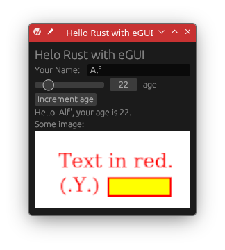
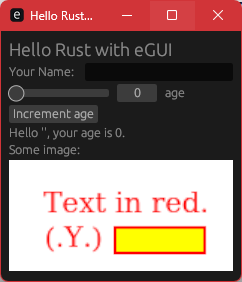

# hello-rust-egui
> Rust GUI example

 

## Deps
```sh
#@ AL10
sudo dnf install rust cargo # Size: 283MB

#@ Win11 & MINGW64
./rustup-init.exe # Size: 1.46GB
```

## Run
```sh
cargo build --release
cargo run --release
cargo clean
```
